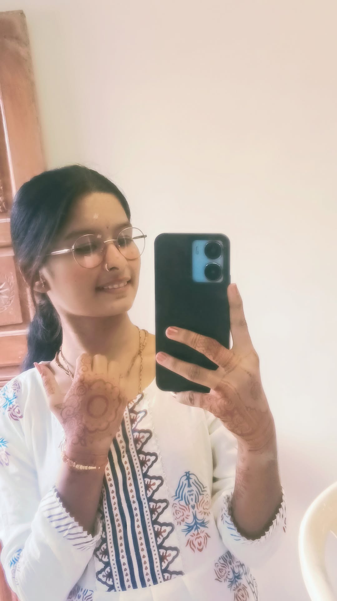

<!DOCTYPE html>
<html lang="en">
<head>
<meta charset="UTF-8">
<meta name="viewport" content="width=device-width, initial-scale=1.0">
<title>A Little Universe For Pratuu ❤️</title>

<link href="https://fonts.googleapis.com/css2?family=Dancing+Script:wght@400;600;700&family=Playfair+Display:ital,wght@0,500;0,600;1,500&family=Poppins:wght@300;400;500&display=swap" rel="stylesheet">

</head>

<body>

<!-- WELCOME -->
<section class="hero">
 
♡

 
A LITTLE WORLD MADE JUST FOR YOU

 <h1>Hey, Pratuu!</h1>
 

  Somewhere between ordinary days and unexpected smiles,
  you became someone very special.
  So I made this little universe just for you. 🌙
 

 <button class="btn" onclick="goTo('birthday')">ENTER YOUR WORLD ✨</button>
 
Scroll down, beautiful ↓

</section>

<!-- COUNTDOWN -->
<section id="birthday">
 
THE DAY THE WORLD GOT MORE BEAUTIFUL

 <h2>It's Your Day! 🎂</h2>
 

  
COUNTING DOWN TO YOUR SPECIAL DAY

  

   
<strong id="days">00</strong><small>DAYS</small>

   
<strong id="hours">00</strong><small>HOURS</small>

   
<strong id="minutes">00</strong><small>MINUTES</small>

   
<strong id="seconds">00</strong><small>SECONDS</small>

  

  
A special day for my favourite girl. ❤️

 

</section>

<!-- PHOTOS -->
<section id="memories">
 
A FACE THAT MAKES MY DAY

 <h2>Your Little Gallery 📸</h2>
 

  

   
   
Your beautiful smile

  

  

   
   
My favourite girl

  

  

   
   
Simply magical

  

  

   
   
One of a kind

  

 

 
Four pictures, countless reasons to smile. 🦋

</section>

<!-- LOVE LETTER -->
<section>
 
SOME WORDS FROM MY HEART

 <h2>For You, My Love 💌</h2>
 

  
Dear Pratuu, ❤️

  

   I may not always find the perfect words,
   but I hope you always know how special you are to me.
  

  

   Your smile, your cute little talks, your nakhre,
   and even the silly moments — somehow, all of them
   make my days a little more beautiful.
  

  

   I don't promise a perfect world,
   but I promise to keep finding little reasons
   to make you smile.
  

  

   On your birthday, I wish you happiness that never ends,
   dreams that come true, and a life full of beautiful surprises.
  

  

   And whenever life gets difficult,
   I hope you remember that someone is always cheering for you.
  

  
Your favourite person ❤️

 

</section>

<!-- SECRET GIFT -->
<section>
 
WAIT... THERE'S ONE MORE THING

 <h2>A Secret For You 🎁</h2>
 

  
🎁

  

   I kept one little surprise hidden here.
   Only you can open it...
  

  <button class="btn" onclick="openGift()">OPEN YOUR GIFT 💗</button>

  

   

   
MY ONE AND ONLY WISH

   <h2>Happy Birthday, Pratuu! ❤️</h2>
   

    If I could gift you one thing in this whole world,
    it would be the ability to see yourself through my eyes.
      
    Then you would know how precious, beautiful
    and special you truly are.
      
    Keep smiling, my princess.
    May your world always be filled with love,
    laughter and magic. 🦋
   

   
🌷 💖 🌙

   
Made only for you.

  

 

</section>

 Made with lots of love, just for Pratuu ❤️
   
 A little universe. A million feelings.

</body>
</html>
