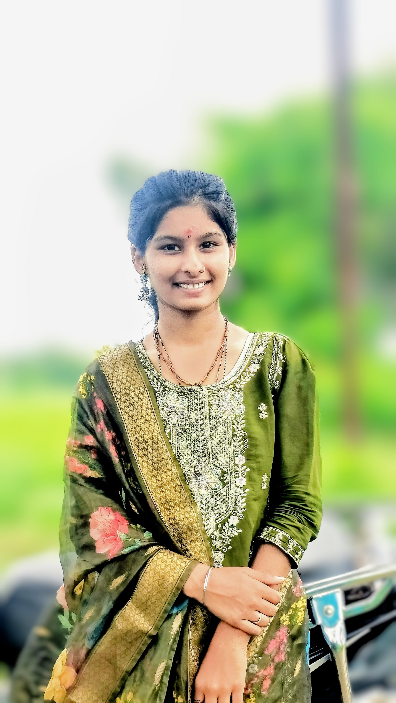

<!DOCTYPE html>
<html lang="mr">
<head>
<meta charset="UTF-8">
<meta name="viewport" content="width=device-width, initial-scale=1.0">
<title>माझ्या बाळासाठी ❤️</title>

<link href="https://fonts.googleapis.com/css2?family=Noto+Sans+Devanagari:wght@400;500;600;700&family=Tiro+Devanagari+Marathi&display=swap" rel="stylesheet">

</head>

<body>

<!-- सुरुवात -->
<section class="hero">
 
❤️

 
♡ फक्त माझ्या बाळासाठी ♡

 <h1>अगं माझ्या बाळा…</h1>
 <h2 style="font-size:27px;margin:12px 0">तुझ्यासाठी काहीतरी खास आहे बघ! 😘</h2>
 

  एकदा उघडून तर बघ… 
  तुझ्यासाठी खूप काही लपवलंय. 
  आणि हो, शेवटपर्यंत नक्की बघायचं हं! 🥹
 

 <button class="btn" onclick="go('birthday')">चल बघूया ❤️</button>
 
खाली अजून सरप्राइज आहेत ↓

</section>

<!-- वाढदिवस -->
<section id="birthday">
 
तो खास दिवस...

 <h2>माझ्या बाळाचा वाढदिवस 🎂</h2>
 

  
तुझ्या खास दिवसाची आतुरतेने वाट पाहतोय...

  

   
<strong id="days">00</strong><small>दिवस</small>

   
<strong id="hours">00</strong><small>तास</small>

   
<strong id="minutes">00</strong><small>मिनिटं</small>

   
<strong id="seconds">00</strong><small>सेकंद</small>

  

  
कारण हा दिवस माझ्यासाठीसुद्धा खूप खास आहे. ❤️

 

</section>

<!-- फोटो -->
<section>
 
माझ्या आवडत्या व्यक्तीचे क्षण

 <h2>माझी सुंदर परी 📸</h2>
 

  

   
   
तुझं गोड हसू ❤️

  

  

   
   
माझी आवडती व्यक्ती 🦋

  

  

   
   
एकदम परीसारखी 🌸

  

  

   
   
माझं छोटंसं जग 💗

  

 

 
तुझे फोटो बघताना वेळ कसा जातो कळतच नाही. 🥹

</section>

<!-- प्रेमपत्र -->
<section>
 
मनातल्या काही गोष्टी...

 <h2>माझ्या बाळासाठी एक पत्र 💌</h2>
 

  
अगं माझ्या बाळा... ❤️

  

   खरं सांगू का, तुला काय लिहावं हेच कधी कधी समजत नाही.
   कारण तू माझ्यासाठी किती खास आहेस हे शब्दांत सांगणं
   थोडंसं कठीण आहे.
  

  

   तुझं हसणं, तुझं बोलणं, तुझे छोटे छोटे नखरे,
   आणि माझी फिरकी घेण्याची तुझी सवय...
   या सगळ्या गोष्टी मला खूप आवडतात. 😁
  

  

   कधी तू रागावतेस, कधी हसवतेस,
   कधी विनाकारण त्रास देतेस...
   पण तरीही तुझ्याशी बोलल्याशिवाय दिवस पूर्ण झाल्यासारखा वाटत नाही.
  

  

   तुझ्या आयुष्यात खूप आनंद यावा,
   तुझी प्रत्येक इच्छा पूर्ण व्हावी,
   आणि तुझ्या चेहऱ्यावरचं हसू असंच कायम राहावं,
   हीच मनापासून इच्छा आहे.
  

  

   आणि हो, कितीही मोठी झालीस तरी
   अशीच गोड, वेडी आणि खोडकर राहायचं! 😘
  

  
तुझाच एक वेडा ❤️

 

</section>

<!-- गुपित भेट -->
<section>
 
अजून एक गोष्ट बाकी आहे...

 <h2>तुझ्यासाठी एक छोटीशी भेट 🎁</h2>
 

  
🎁

  

   अगं, ही भेट उघडण्याआधी एकदा हसून दाखव बरं! 😁
  

  <button class="btn" onclick="openSurprise()">इथे क्लिक कर बघू 😘</button>

  

   

   <h2>वाढदिवसाच्या खूप खूप शुभेच्छा माझ्या बाळा! ❤️</h2>
   

    अगं वेडे, तुला या जगातलं सगळं सुख मिळावं.
    तुझ्या प्रत्येक स्वप्नाला सुंदर पंख मिळावेत.
      
    आयुष्याच्या प्रत्येक वळणावर तुला आनंद भेटावा,
    तुझ्या चेहऱ्यावरचं हसू कधीच कमी होऊ नये.
      
    आणि एक गोष्ट लक्षात ठेव...
    तू आहेस तशीच खूप खास आहेस.
    कधी स्वतःची किंमत कमी समजू नकोस.
      
    खूप खूप प्रेम माझ्या परी! 🥹😘
   

   
🌷🦋💗🎂

   
फक्त तुझ्यासाठी ❤️

  

 

</section>

 माझ्या बाळासाठी, खूप साऱ्या प्रेमाने ❤️
  
 ही छोटीशी दुनिया फक्त तुझीच आहे. 🦋

<!-- MY HEART TO YOU ❤️ -->
<section class="my-love-letter">
  
💌

  <h2>माझ्या बाळासाठी… ❤️</h2>
  
मनातलं थोडंसं… 🥹

  

    
बाळा, ऐक ना… एक सांगू? 🥹

    

      माझं तुझ्यावर किती प्रेम आहे, ते मी तुला
      शब्दांत सांगू शकत नाही. पण जेवढं काही आहे,
      ते सगळं तुझ्यावरच आहे आणि कायमस्वरूपी राहणार.
    

    

      मी प्रॉमिस देतो तुला, मी तुला कधीच Hurt
      करणार नाही. फक्त माझी एकच इच्छा आहे,
      तू मला कधीच एकटं सोडू नकोस.
    

    

      तुला खूप सुखी ठेवण्यासाठी माझ्याकडून
      जेवढं होईल तेवढं करण्याचा मी नेहमी प्रयत्न करेन.
      काय माझं नशीब, देवाने तुला माझ्यासोबत जोडलं! ❤️
    

    

      त्या देवाकडे पण माझी एकच मागणी आहे…
      जसं आपल्याला जोडलं, तसंच शेवटपर्यंत
      आपल्याला एकमेकांसोबत ठेव. 🥹
    

    

      आज मी खूप खुश आहे, कारण आज माझ्या
      लाडक्या बायकोचा Birthday आहे! 😘
    

    

      आणि शेवटी परत एकदा माझ्या बायकोला
      माझ्याकडून वाढदिवसाच्या खूप खूप शुभेच्छा!
      तू कायम खुश राहा. 😘🩷
    

    <h3>आणि हो… 😅</h3>
    

      असाच माझ्यासोबत भांडत रहा! 😅😘
    

    

      फक्त तुझाच… ❤️
    

  

  
Forever & Always ♾️

</section>

<!-- SECRET SURPRISE FOR PRATUU 🥹❤️ -->

<section class="secret-love">
  
🦋

  <h2>बाळा, तुझ्यासाठी एक छोटंसं Surprise! ❤️</h2>

  
माझ्यासाठी एकदा डोळे बंद कर ना… 🥹

  <button id="secretLoveBtn">
    इथे क्लिक कर माझ्या बाळा 💗
  </button>

  

    
💖

    <h2>आता डोळे उघड! 😘</h2>

    

      तुझ्यासाठी माझं संपूर्ण जग इथे आहे…
      आणि त्या जगातली सर्वात सुंदर गोष्ट म्हणजे तू! 🥹
    

    <h3>तू आहेस म्हणून माझं जग सुंदर आहे! ❤️</h3>

    
खूप खूप प्रेम करतो तुझ्यावर, माझ्या बायको! 😘🩷

    
Forever Mine ♾️

  

</section>

</body>
</html>
